# Phase 0 — Platform Bring-Up & OS Deployment

## Overview

This phase documents the initial bring-up of the Dell OptiPlex 7050 that became my homelab server.

The goal was to establish a known-good hardware and software baseline before replacing the existing Windows installation with Ubuntu Server. The process included physical inspection, hardware and operating-system diagnostics, installation-media preparation, Ubuntu Server deployment, and confirmation of a successful local login.

The phase ends at the first successful local Ubuntu login. Post-install validation, networking, SSH configuration, firewalling, and other administration tasks are documented in later phases.

---

## 1. Physical Inspection

### Front I/O

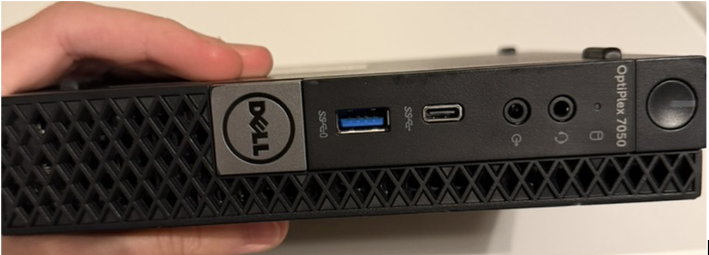

Initial physical inspection of the Dell OptiPlex 7050, including the chassis and front I/O.

The system was documented before making hardware or software changes so the original physical condition and available connectivity were recorded.

### Rear I/O

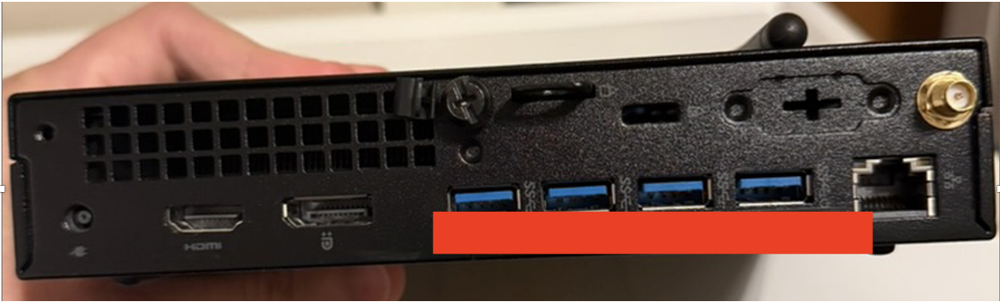

Rear I/O inspection of the OptiPlex 7050 before deployment.

The rear panel was documented to establish the available wired networking, display, USB, and expansion connectivity before the system was converted into a server.

---

## 2. Existing System Baseline

### Windows Hardware and Software Baseline

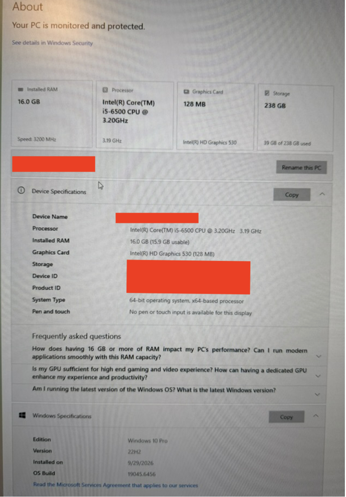

Hardware and Windows baseline captured from the system's existing Windows 10 installation.

The system reported:

- Intel Core i5-6500 processor
- 16 GB RAM
- Intel HD Graphics 530
- Approximately 238 GB of usable storage
- 64-bit system architecture
- Windows 10 Pro 22H2

This provided a reference point for the hardware that Ubuntu Server would later run on.

### Storage Health Check

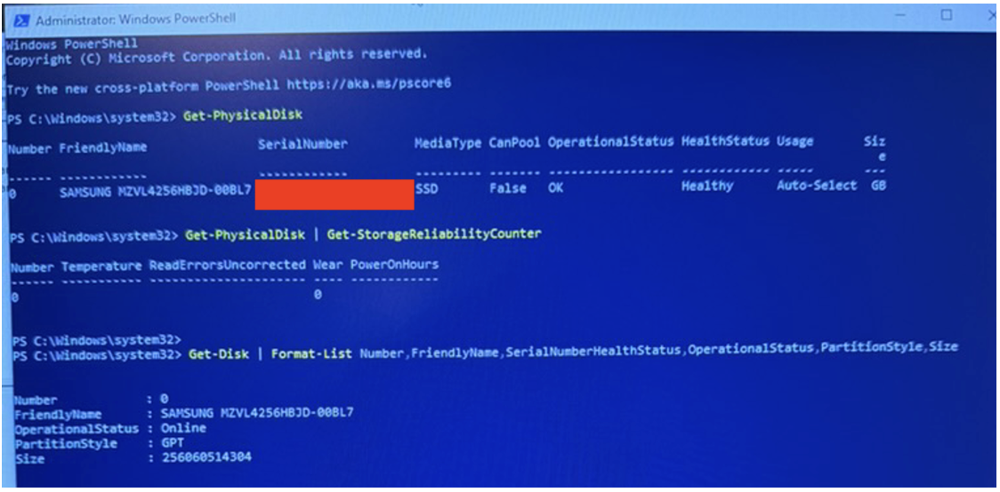

PowerShell storage checks showed the installed NVMe SSD as online and reported healthy before the operating-system migration.

The checks also documented the disk model, partition style, capacity, and available reliability information.

---

## 3. Firmware and System Diagnostics

### UEFI/BIOS Inspection

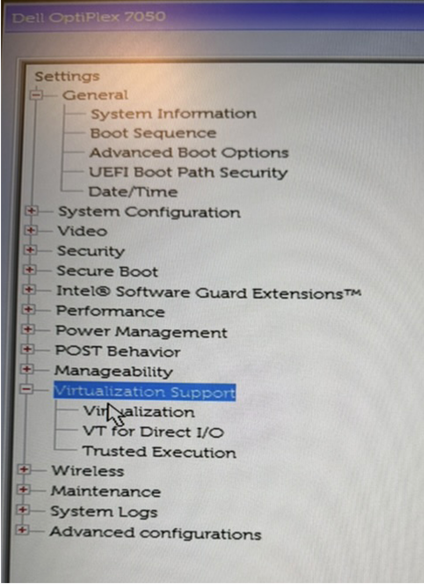

Dell UEFI/BIOS inspection of the system's virtualization-related settings.

This screenshot documents review of the available virtualization configuration options before Ubuntu Server deployment.

### Windows Integrity Check

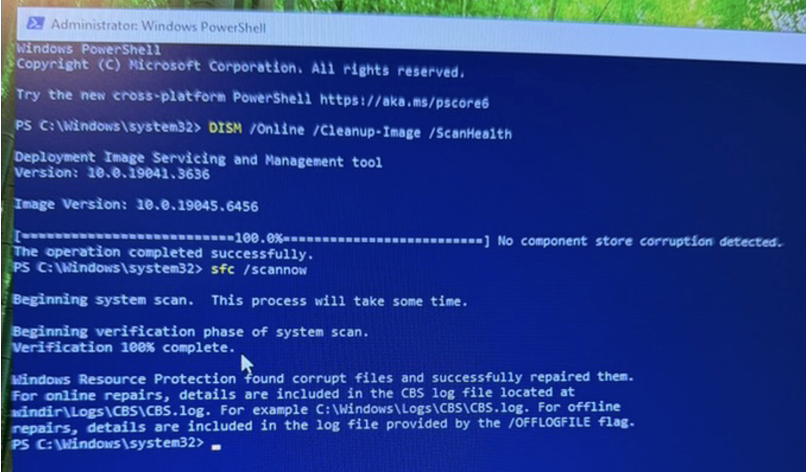

Windows integrity checks were performed using DISM and System File Checker.

DISM reported no component-store corruption. The initial `sfc /scannow` run found corrupted Windows system files and reported that they were repaired successfully.

### Follow-Up Integrity Verification

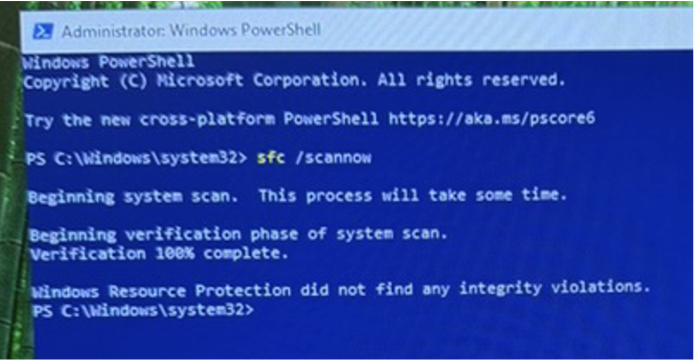

A second System File Checker run reported no remaining integrity violations after the previous repair.

This provided a simple detect → repair → verify workflow before replacing the original operating system.

---

## 4. Installation Media Preparation

### Ubuntu Server ISO Hash

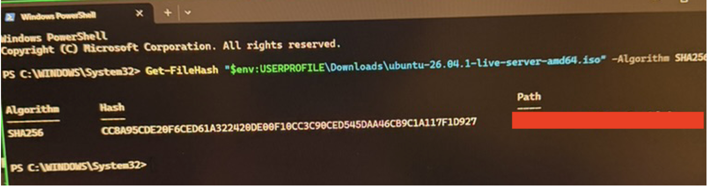

A SHA-256 hash was calculated for the downloaded Ubuntu Server installation image using PowerShell's `Get-FileHash` command before the ISO was used for installation media.

---

## 5. Hardware Validation

### Dell ePSA Diagnostics

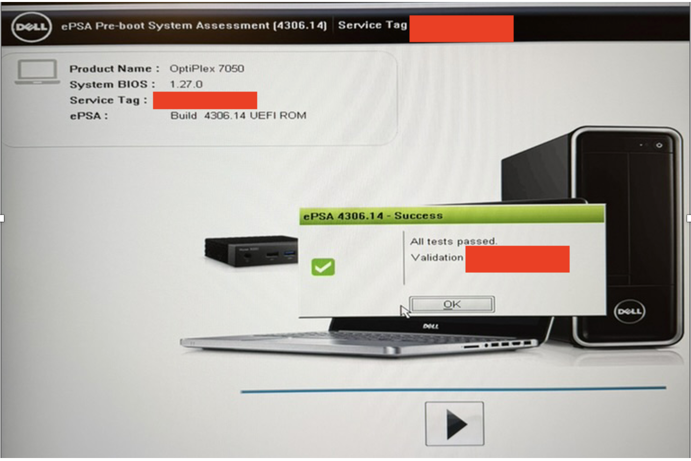

Dell ePSA pre-boot diagnostics completed successfully before Ubuntu Server installation.

The built-in diagnostic suite reported that all tested hardware passed.

---

## 6. Ubuntu Server Deployment

### Storage Configuration

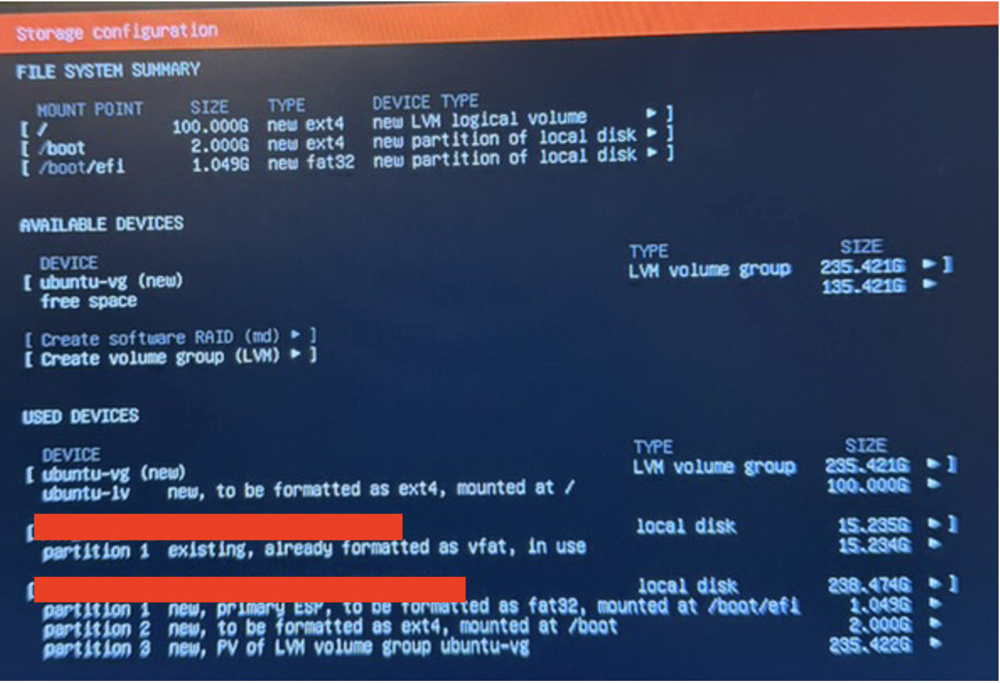

Ubuntu Server storage configuration using LVM with separate EFI and `/boot` partitions.

The installation layout included:

- EFI System Partition mounted at `/boot/efi`
- Dedicated `/boot` partition
- LVM-backed root filesystem mounted at `/`

### First Successful Local Login

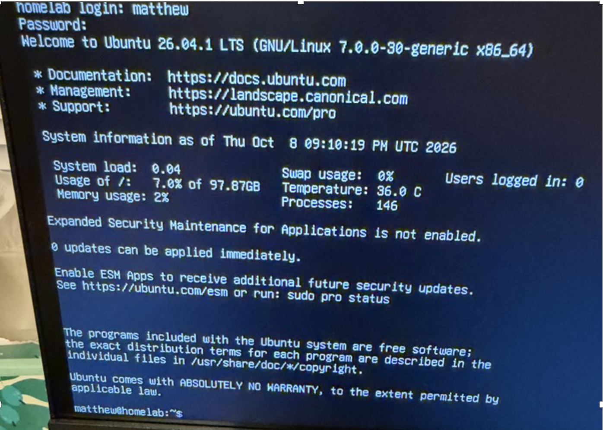

First successful local login to Ubuntu Server 26.04.1 LTS after installation to the OptiPlex's internal SSD.

This marked the completion of the initial platform bring-up and operating-system deployment. Ubuntu Server booted successfully and presented a working local shell under the `homelab` hostname.

---

## Phase Result

The Dell OptiPlex 7050 passed the initial physical and hardware checks, the existing Windows installation was inspected and validated, Ubuntu Server installation media was prepared, and Ubuntu Server 26.04.1 LTS was successfully deployed.

**Completion milestone:** successful local Ubuntu login from the installed system.

## Next Phase

**Phase 1 — Baseline Validation & Secure Remote Administration**

The next phase covers post-install validation, system configuration, secure SSH access, firewalling, updates, and headless administration.
