# Phase 1 — Baseline Validation & Secure Remote Administration

## Overview

This phase documents the post-install validation and initial administration of the Dell OptiPlex 7050 after Ubuntu Server was successfully deployed in Phase 0.

The goal was to move the system from a working local Ubuntu installation to a validated and remotely manageable server. The process included confirming the installed operating system and storage layout, bringing up wired networking, installing and validating OpenSSH, configuring key-based remote administration, enabling a host firewall, hardening SSH authentication, checking system health, establishing predictable LAN addressing, configuring automated security updates, and reviewing firmware and Secure Boot state.

The phase begins immediately after the first successful local Ubuntu login documented at the end of Phase 0.

Additional troubleshooting and lower-level implementation evidence is retained in the [Phase 1 Setup Notes](setup-notes/README.md).

---

## 1. Post-Install System Baseline

### Operating System and Kernel Validation

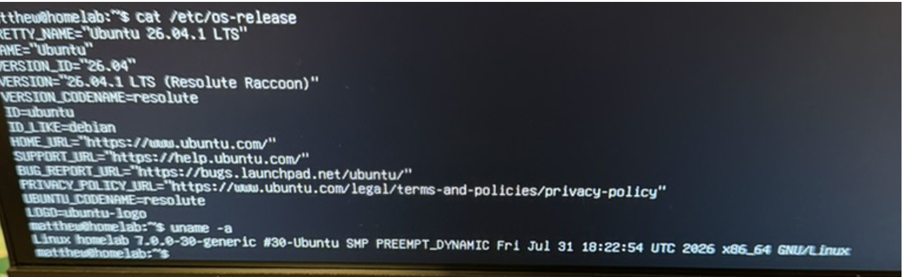

Post-install validation confirmed that the server was running Ubuntu Server 26.04.1 LTS on the expected Linux kernel and x86-64 architecture under the `homelab` hostname.

This established the initial software baseline for the installed system before further configuration began.

### UEFI and Storage Validation

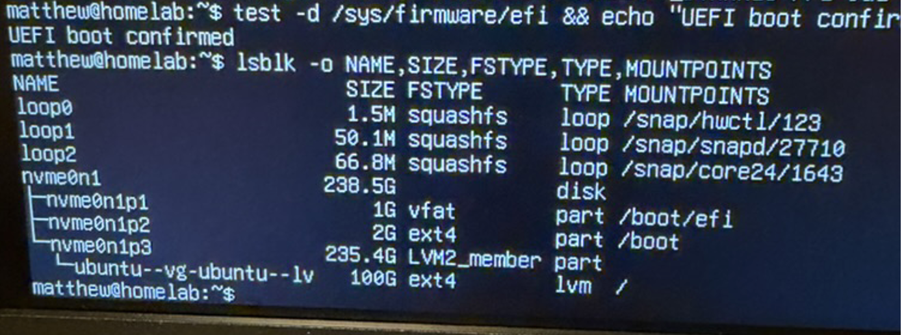

The running system was confirmed to have booted in UEFI mode, and the resulting storage layout was inspected with `lsblk`.

The installed layout included:

- EFI System Partition mounted at `/boot/efi`
- Dedicated ext4 `/boot` partition
- LVM-backed storage
- 100 GB ext4 logical volume mounted at `/`

This verified that the storage configuration selected during installation was present on the running system.

### Firmware Security Baseline

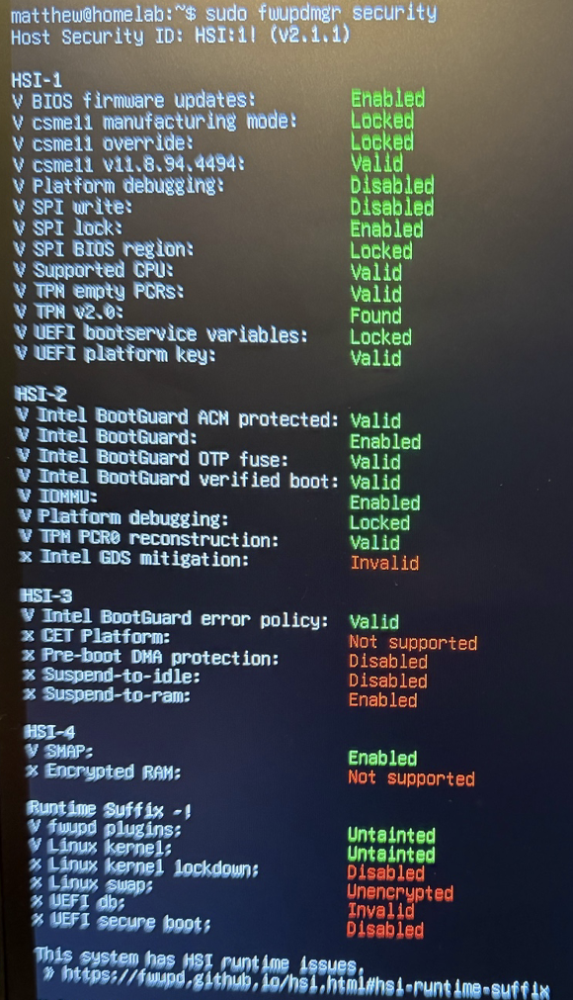

An initial firmware and platform-security assessment was performed with `fwupdmgr security`.

The assessment documented the system's Host Security ID, supported firmware protections, TPM availability, Intel BootGuard state, UEFI security properties, and several remaining runtime-security limitations.

This output was treated as a baseline assessment rather than evidence that every reported security capability had been enabled or remediated.

---

## 2. Network Bring-Up and Validation

### Initial Interface State

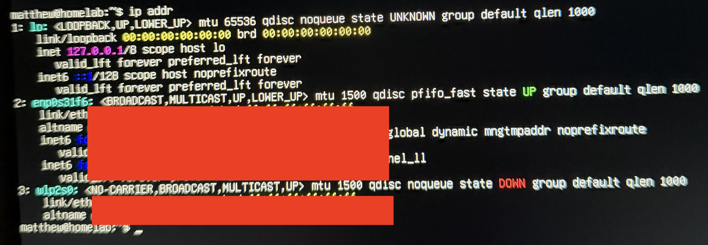

The server's initial interface state was inspected with `ip addr`.

The Intel Ethernet interface was detected and operational at the link level, but useful IPv4 network configuration had not yet been established.

### Initial Netplan and Routing State

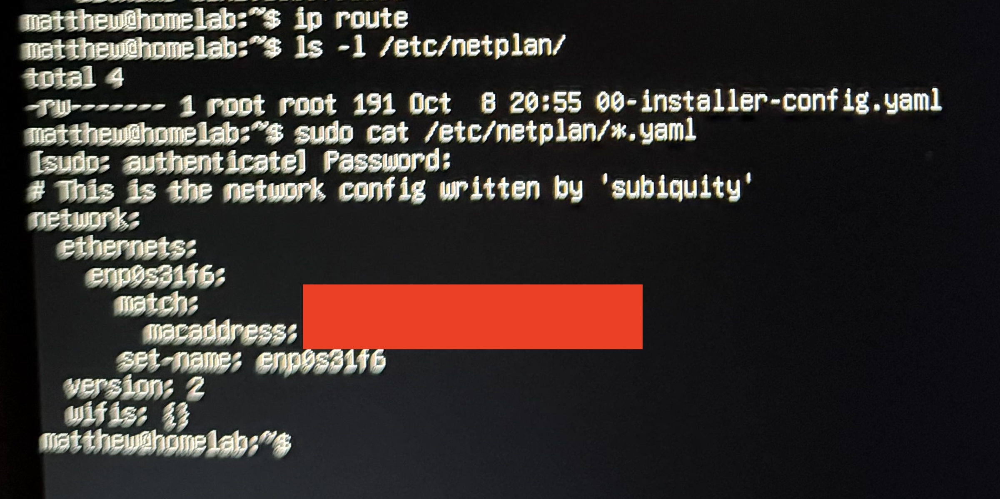

The routing table and installer-generated Netplan configuration were inspected to determine the server's starting network state.

The inspection showed the existing Ethernet configuration before DHCP was explicitly enabled.

### DHCP Configuration

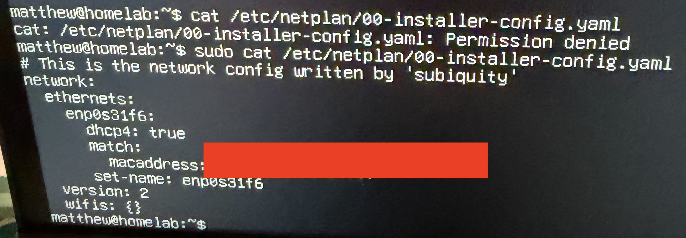

The installer-generated Netplan configuration was updated to enable IPv4 DHCP on the server's Ethernet interface.

This provided the configuration needed for the interface to obtain an IPv4 address and route dynamically from the LAN.

### Connectivity Validation

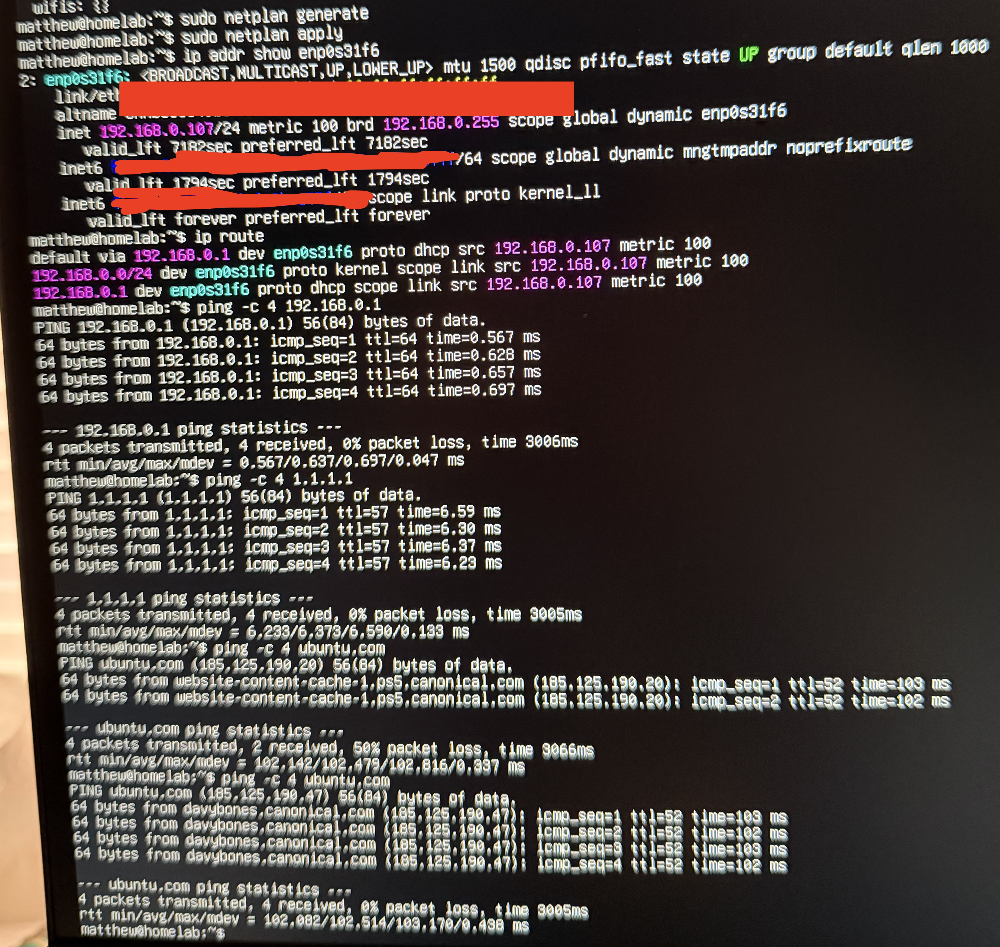

The updated Netplan configuration was generated and applied, followed by layered connectivity testing.

Validation included:

- Ethernet interface addressing
- Default route installation
- Reachability of the local gateway
- External connectivity by IP address
- DNS resolution
- External connectivity by hostname

These checks confirmed that the server had functional LAN and Internet connectivity.

---

## 3. OpenSSH Installation

### OpenSSH Server Installation

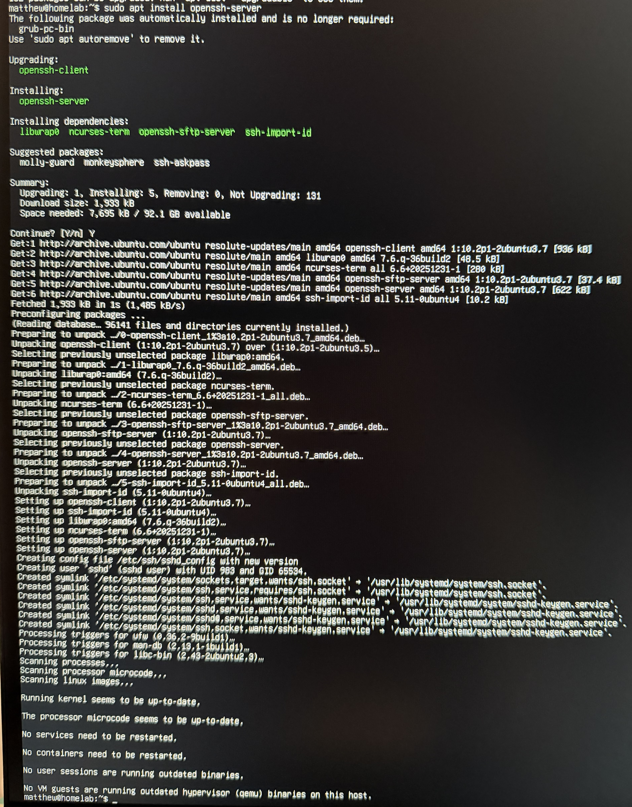

The OpenSSH server package and its required dependencies were installed through APT.

Package configuration completed successfully and created the systemd components needed to provide SSH access.

### SSH Socket Validation

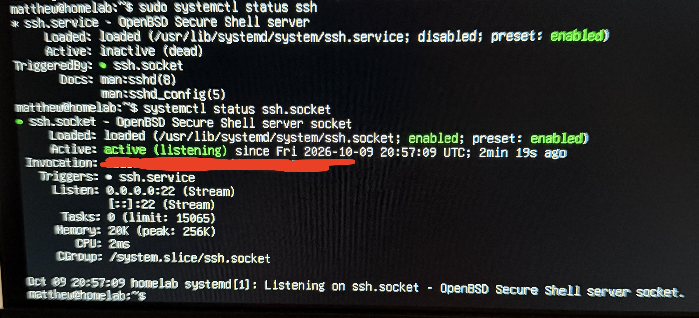

The OpenSSH service state was inspected after installation.

Ubuntu was using systemd socket activation: the traditional `ssh.service` was inactive until needed, while `ssh.socket` was enabled and actively listening on TCP port 22.

This confirmed that the server was ready to accept SSH connections.

---

## 4. Secure Remote Administration

### Dedicated SSH Key and Public-Key Authentication

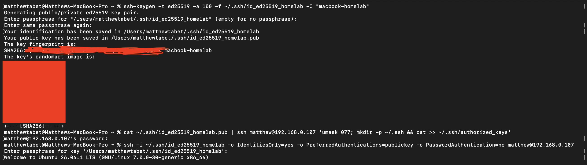

A dedicated ED25519 SSH key was generated on the Mac used for administration.

The public key was installed in the server account's `authorized_keys` file, and a test connection was performed with public-key authentication explicitly required and password authentication disabled for the test.

The successful login confirmed that key-based remote administration was functioning independently of password fallback.

### SSH Client Configuration and Alias

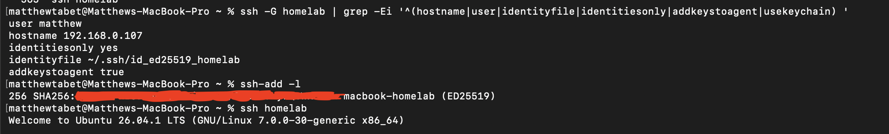

The Mac's effective SSH client configuration was validated to confirm the intended hostname, user, identity file, and SSH-agent behavior.

A normal connection using:

`ssh homelab`

successfully reached the Ubuntu server.

This established the shorter SSH workflow used for routine administration.

Additional host-key and authentication troubleshooting from the initial remote-access setup is retained in the [Setup Notes](setup-notes/README.md).

---

## 5. SSH Hardening

### Pre-Hardening Baseline

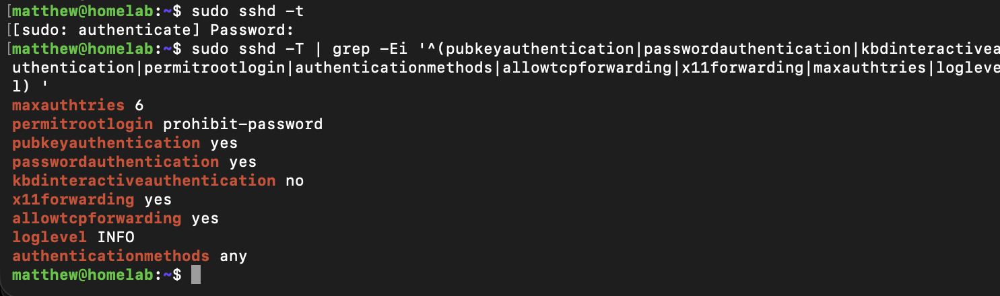

The effective OpenSSH server configuration was recorded before hardening changes were applied.

The baseline included:

- `PasswordAuthentication yes`
- `PubkeyAuthentication yes`
- `PermitRootLogin prohibit-password`
- `MaxAuthTries 6`
- `X11Forwarding yes`
- `AllowTcpForwarding yes`

Capturing the effective configuration before modification provided a direct comparison point for the hardened state.

---

## 6. Host Firewall

### UFW Activation and LAN-Scoped SSH Access

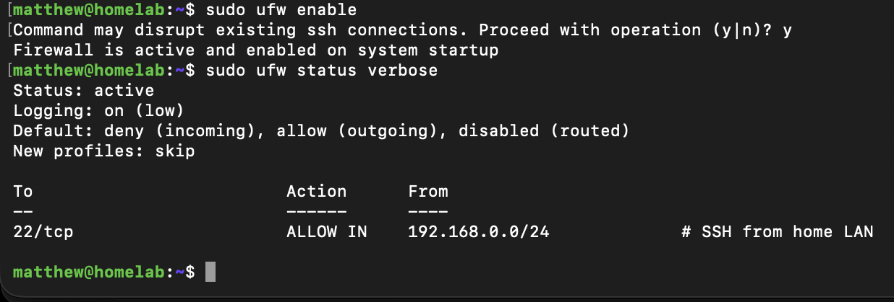

UFW was enabled with a default-deny inbound policy and default-allow outbound policy.

SSH access on TCP port 22 was restricted to the local `192.168.0.0/24` network.

The firewall was also confirmed to be enabled for system startup.

The command-by-command firewall configuration process is retained in the [Setup Notes](setup-notes/README.md).

---

## 7. SSH Hardening and Verification

### Hardened OpenSSH Configuration

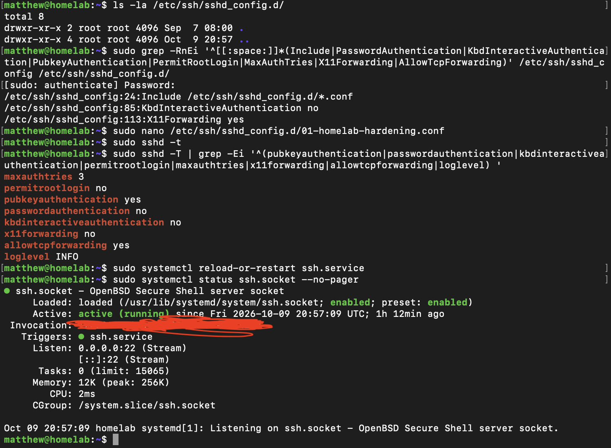

A dedicated OpenSSH configuration override was created under `/etc/ssh/sshd_config.d/`.

The effective configuration after hardening included:

- `MaxAuthTries 3`
- `PermitRootLogin no`
- `PubkeyAuthentication yes`
- `PasswordAuthentication no`
- `KbdInteractiveAuthentication no`
- `X11Forwarding no`
- `AllowTcpForwarding yes`
- `LogLevel INFO`

The SSH configuration passed validation, and the SSH socket remained operational after the changes were applied.

### Authentication Behavior Verification

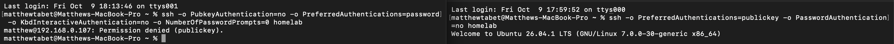

The hardened authentication behavior was tested directly rather than relying only on configuration-file output.

A connection attempt that excluded public-key authentication was denied, while a connection explicitly requiring public-key authentication succeeded.

This confirmed that the server's observed SSH behavior matched the hardened configuration.

### Firewall and Remote-Access Verification

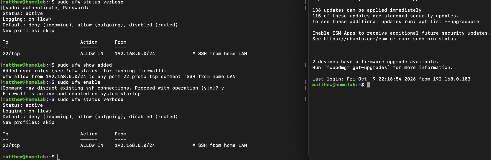

The active UFW configuration was checked alongside a fresh SSH login from another device on the home LAN.

This verified that the LAN-scoped firewall rule continued to permit legitimate remote administration while inbound access remained restricted by the firewall policy.

---

## 8. System Health and Update State

### System and Package Health

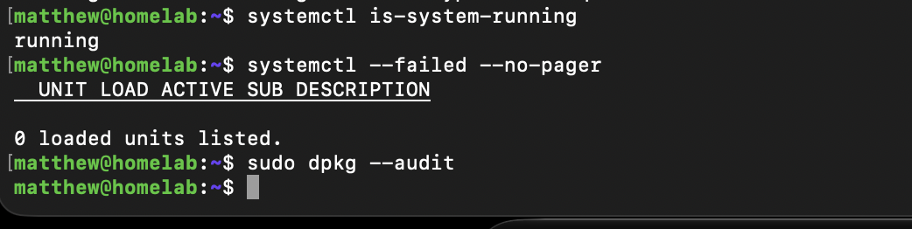

Basic system-health checks confirmed that:

- systemd reported the system as running
- no failed systemd units were present
- `dpkg --audit` reported no package-consistency findings

This provided a clean operational baseline after the initial networking and remote-administration work.

### Reboot and Service State

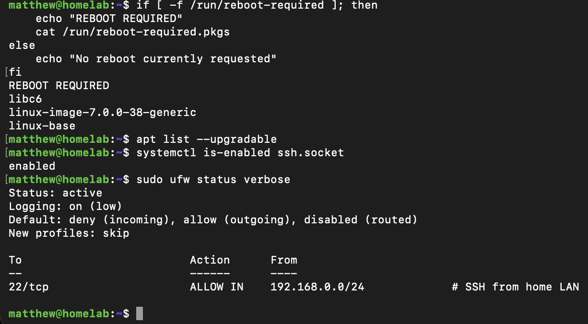

The system reported that a reboot was required after package changes, including an updated Linux kernel.

The server was also checked to confirm that:

- the SSH socket remained enabled
- UFW remained active
- the LAN-scoped SSH rule remained present

This documented the expected post-update reboot state while verifying that the remote-administration security controls remained configured.

---

## 9. Stable LAN Addressing

### DHCP Reservation

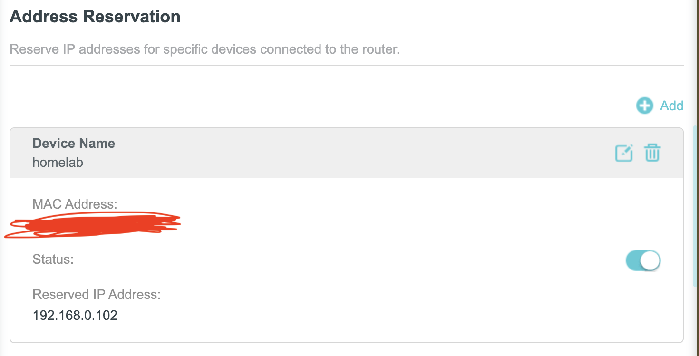

A DHCP reservation was configured for the `homelab` server, assigning the predictable LAN address `192.168.0.102`.

Stable addressing simplified SSH access and provided a consistent address for later services and administration.

---

## 10. Automated Security Updates

### Unattended-Upgrades and APT Timers

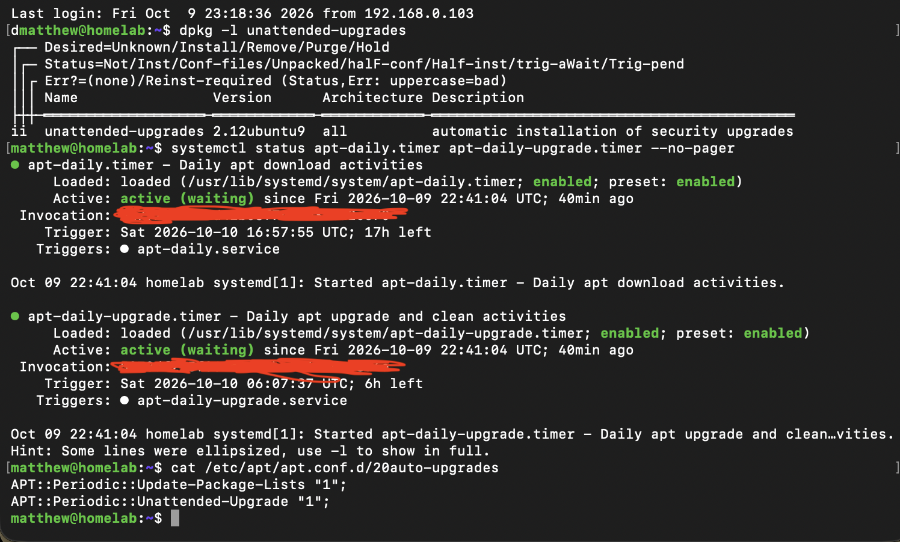

The `unattended-upgrades` package was confirmed installed, and the associated APT systemd timers were verified as enabled and active.

The periodic APT configuration also confirmed that automatic package-list updates and unattended upgrades were enabled.

### Allowed Update Origins

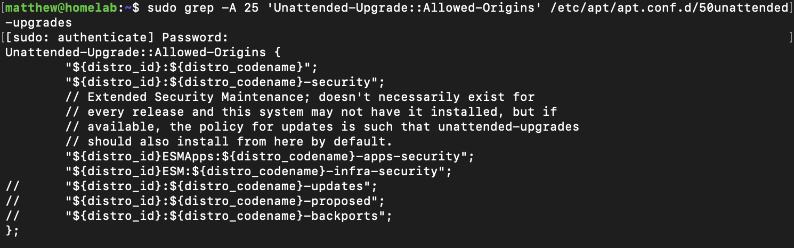

The unattended-upgrades policy was inspected to identify the package origins permitted for automatic installation.

The configuration included the Ubuntu release and security update origins, establishing the policy used by the automated update mechanism.

### Dry-Run Validation

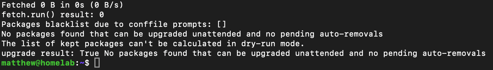

An unattended-upgrades dry run completed successfully.

At the time of validation, no packages were eligible for unattended installation and no pending automatic removals were reported.

The successful dry run confirmed that the unattended-upgrades mechanism could evaluate the configured system without applying changes.

---

## 11. Firmware and Secure Boot Validation

### Secure Boot and EFI Boot State

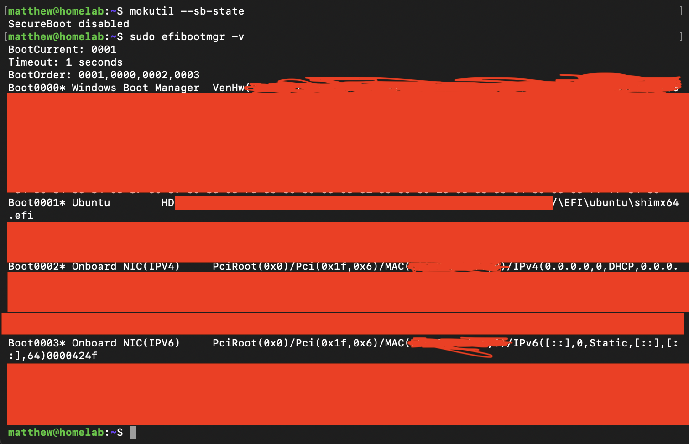

Secure Boot state and the system's EFI boot configuration were inspected.

`mokutil` reported Secure Boot as disabled, while `efibootmgr` documented the configured Ubuntu, Windows Boot Manager, and network boot entries.

Secure Boot remained disabled during this phase; the objective here was to document and understand the existing firmware and boot state rather than change it without a recovery and rollback plan.

Additional signed-bootloader and EFI-file inspection is retained in the [Setup Notes](setup-notes/README.md).

---

## Phase Result

The Ubuntu Server installation was validated after deployment, wired networking was successfully configured and tested, OpenSSH was installed, and key-based remote administration from the Mac was established.

The server was further secured with a host firewall and hardened SSH configuration. System health was validated, predictable LAN addressing was established, unattended security-update functionality was configured and tested, and the current firmware and Secure Boot state was documented.

**Completion milestone:** a validated Ubuntu Server installation with functional networking, key-based SSH administration, LAN-scoped firewall protection, hardened remote authentication, stable addressing, and automated security-update capability.

## Supporting Documentation

Detailed troubleshooting and implementation evidence that supports this phase without being required for the primary narrative is available in the [Phase 1 Setup Notes](setup-notes/README.md).

## Next Phase

**Phase 2 — UPS Monitoring & Power Integration**

The next phase documents integration and validation of UPS monitoring with Network UPS Tools (NUT), including device compatibility, USB/HID communication, UPS telemetry, and power-state monitoring.