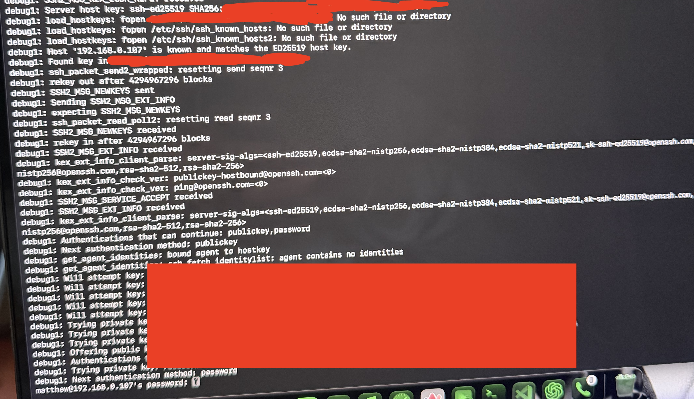
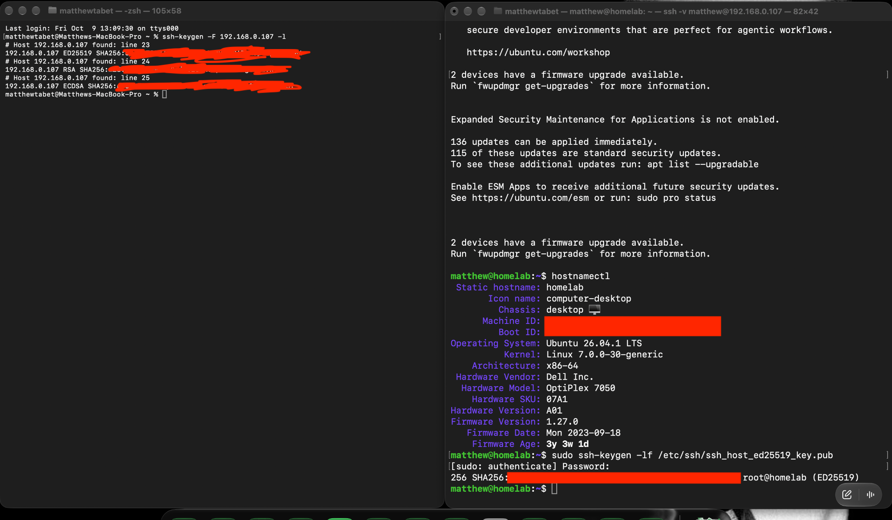
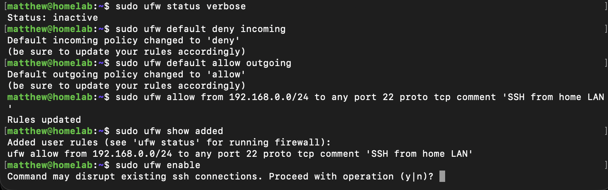
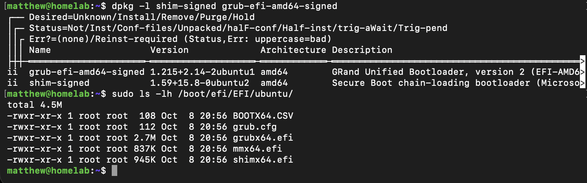

# Phase 1 — Setup Notes

## Overview

These notes contain supporting evidence from Phase 1 — Baseline Validation & Secure Remote Administration.

The main Phase 1 README focuses on completed configuration states and the primary implementation sequence. This document retains intermediate troubleshooting, detailed configuration steps, and lower-level validation that provide useful technical context without interrupting the main project narrative.

The image numbers remain aligned with the original Phase 1 chronology.

[Return to the main Phase 1 documentation](../README.md).

---

## 1. Remote Access Troubleshooting

### Initial SSH Authentication Troubleshooting

A verbose SSH connection attempt from the Mac was used to inspect the initial authentication process.

The diagnostic output showed that:

- the server's host key was recognized
- both public-key and password authentication were available
- the SSH agent did not yet contain a usable identity
- attempted local key files did not complete authentication
- the connection ultimately fell back to a password prompt

This captured the intermediate authentication state before the dedicated homelab SSH key was created and successfully configured.

The completed key-based authentication setup is documented in the main Phase 1 README.

### SSH Host Identity Verification

The Mac's stored SSH host-key information was compared with the server's actual SSH host identity.

The server was also inspected with `hostnamectl` to confirm the operating system, hardware model, kernel, and firmware context associated with the SSH endpoint.

This troubleshooting step helped verify that the host key stored by the Mac corresponded to the intended `homelab` server rather than an unexpected system.

The session also recorded that firmware upgrades were reported as available at that point in the setup process.

---

## 2. Firewall Configuration Details

### UFW Rule Construction

Before UFW was enabled, its initial state and intended rule set were reviewed and configured.

The process included:

- confirming that UFW was initially inactive
- setting the default inbound policy to deny
- setting the default outbound policy to allow
- permitting TCP port 22 only from the `192.168.0.0/24` home LAN
- reviewing the pending rule before firewall activation

The screenshot ends at UFW's warning that enabling the firewall could disrupt the existing SSH connection.

The resulting active firewall configuration is documented in the main Phase 1 README.

---

## 3. Firmware and Boot Details

### Signed Bootloader Packages and EFI Files

Additional boot-chain inspection confirmed that the signed GRUB and shim packages were installed.

The Ubuntu EFI directory was also inspected and contained boot-related files including:

- `BOOTX64.CSV`
- `grub.cfg`
- `grubx64.efi`
- `mmx64.efi`
- `shimx64.efi`

This provides lower-level supporting context for the Secure Boot and EFI-state assessment documented in the main Phase 1 README.

The presence of signed bootloader components does not by itself indicate that Secure Boot is enabled. The main Phase 1 validation separately confirmed that Secure Boot was disabled during this phase.

---

## Setup Notes Result

These supporting checks preserve the troubleshooting and lower-level implementation context behind Phase 1's completed configuration.

They document how SSH authentication issues were investigated, how the server's SSH host identity was verified, how the firewall rule set was constructed before activation, and how the installed signed bootloader and EFI components were inspected.

[Return to Phase 1 — Baseline Validation & Secure Remote Administration](../README.md).